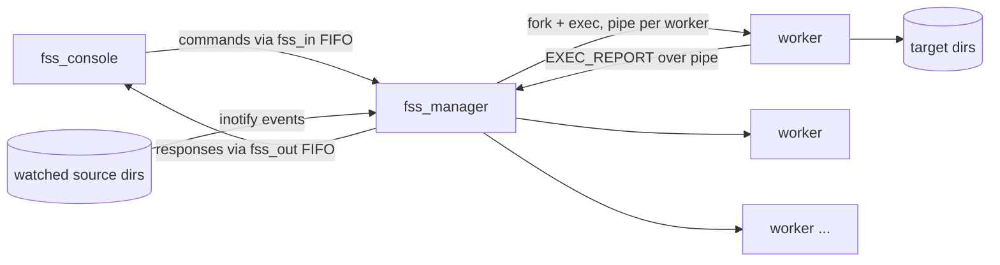

# File Sync System (FSS)

A Linux service written in C that **watches directories in real time and keeps them mirrored** to target directories. A long-running manager process uses `inotify` to detect file changes and dispatches the copy and delete work to a bounded pool of worker processes. An interactive console talks to the manager over named pipes.

> Built for the *System Programming* course (Dept. of Informatics & Telecommunications, University of Athens, Spring 2025).

## Architecture



- **`fss_manager`** is the core daemon. It:
  - reads source → target pairs from a config file and runs an initial **full sync** for each pair
  - registers an `inotify` watch per source directory (`IN_CREATE`, `IN_CLOSE_WRITE`, `IN_DELETE`)
  - multiplexes console commands and filesystem events with **`poll()`** on the FIFO and the inotify descriptor
  - spawns workers with **`fork()` + `execvp()`**, capping concurrency at `-n <worker_limit>`. Extra jobs wait in a FIFO **task queue** (a custom deque)
  - reaps finished workers in a **`SIGCHLD` handler**, parses their reports and starts the next queued job
  - keeps per-directory state (last sync time, error count, active or inactive) and writes a timestamped log
- **`worker`** runs one sync operation (`FULL`, `ADDED`, `MODIFIED` or `DELETED`) with low-level `open/read/write/unlink`. Its `stdout` is redirected into a pipe, and it sends back a structured report (`EXEC_REPORT_START … EXEC_REPORT_END`) with per-file errors.
- **`fss_console`** is an interactive shell that sends commands to the manager and logs every command and response.

## Console commands

| Command | Description |
|---|---|
| `add <source> <target>` | Start monitoring a new directory pair (runs a full sync first) |
| `status <source>` | Show last sync time, error count and active status |
| `sync <source>` | Force a full re-sync of a directory |
| `cancel <source>` | Stop monitoring a directory (removes the inotify watch) |
| `shutdown` | Wait for active workers, drain the queue, clean up the FIFOs and exit |

## Build & run

Requires Linux (uses `inotify`) and `gcc`/`make`.

```bash
make

# terminal 1: start the manager (config file has one "source target" pair per line)
./fss_manager -l manager.log -c examples/config.txt -n 5

# terminal 2: start the console
./fss_console -l console.log
```

Example session:

```text
Enter input (add/cancel/status/sync/shutdown): status /tmp/s1
[2025-04-29 20:59:00] Status requested for /tmp/s1
Directory: /tmp/s1
Target: /tmp/t1
Last Sync: 2025-04-29 20:58:56
Errors: 0
Status: Active
```

Manager log after a file was edited in the watched directory:

```text
[2025-04-29 20:58:56] [/tmp/s1] [/tmp/t1] [913] [FULL] [SUCCESS] [2 files copied, 0 skipped]
[2025-04-29 20:58:58] [/tmp/s1] [/tmp/t1] [922] [MODIFIED] [SUCCESS] [File : b.txt]
```

## Project structure

```
src/
  fss_manager.c          manager daemon: inotify, poll loop, worker pool, SIGCHLD handling
  worker.c               performs one sync operation and reports back
  fss_console.c          interactive client over named pipes
  Deque_Implementation.c task queue and running-workers bookkeeping
include/
  Deque_Interface.h, variables.h
examples/config.txt      sample config
```

## Concepts demonstrated

Process management (`fork`, `execvp`, `waitpid`) · signals (`SIGCHLD`) · named pipes and anonymous pipes · I/O redirection with `dup2` · I/O multiplexing with `poll` · filesystem events with `inotify` · low-level file I/O · custom data structures in C

## Author

**Giorgos Fragkakis** · [GitHub](https://github.com/fragk17)
